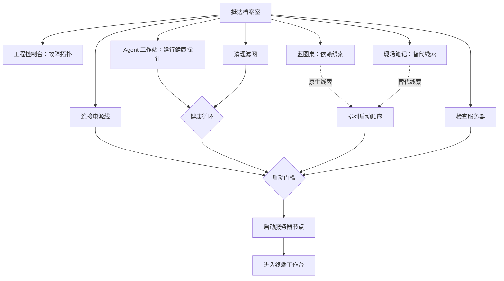

# Signal Archive 游戏逻辑总纲

> 状态：玩法与内容架构草案 v1
>
> 本文定义完整体验、规则和实现边界，不代表游戏功能已经开发完成。具体个人经历仍使用内容插槽，避免在作者确认前虚构事实。

## 1. 一句话定义

访客以“档案员”的身份进入一座失去信号的个人档案室，通过观察真实痕迹、理解系统关系并恢复服务器，逐步认识作者的作品、选择和思考；启动后的显示器会进入已经存在的终端工作台。

这不是黑客入侵游戏，也不是把个人履历藏进谜题。它是一层**可选择、可跳过、可重访的叙事体验**。

## 2. 产品位置

终端仍然是个人网站的主要入口，游戏作为另一条同等真实的探索路径存在。任何作品、履历、联系方式和终端功能都不能被游戏进度锁住。

```text
                    ┌────────────────────┐
                    │ me.ccsert.top 入口 │
                    └─────────┬──────────┘
                              │
                 ┌────────────┴────────────┐
                 │                         │
        直接进入终端工作台           开始探索档案室
                 │                         │
                 │                  恢复本地档案节点
                 │                         │
                 └────────────┬────────────┘
                              │
                     同一套内容与进度
```

设计结论：

- 游戏不是门禁，终端始终可以直接访问。
- 游戏内启动的是“本地档案节点”，不会解释成解锁整个网站。
- 从游戏进入终端时，终端会继承房间状态和刚发现的内容。
- 从终端返回游戏时，房间保持已恢复状态，不重放开场。
- 游戏和终端共享主题、动效偏好、声音偏好与内容状态。

### 2.1 档案室入口

首次打开档案室只给三个明确出口：

- 主操作：`开始探索`；
- 次操作：`直接进入终端`；
- 辅助入口：`辅助功能与快速浏览`。

不要要求访客先选择“技术人员、招聘者或玩家”身份。系统通过访客是否使用提示、是否直接进入终端、所用输入设备和是否重访自然调整体验。

首次加载不自动抢占键盘。第一个焦点落在标题或跳过链接；开始探索后才激活角色控制。时间有限的访客还可以在辅助入口中选择 90 秒故事浏览，它使用同一内容和存档，不是删减版结局。

## 3. 玩家幻想与情绪目标

### 玩家身份

访客控制的是“档案员”化身。档案员不是作者本人，也不是拥有独立背景的角色；它只是访客在世界中的身体。

### 玩家目标

玩家不是为了获得高分，而是完成三件事：

1. 发现这个房间为什么失去回应；
2. 从设备和记录中理解作者曾经面对的问题；
3. 让档案重新发声，并决定继续在房间或终端中探索。

### 情绪曲线

```text
陌生但安全 → 好奇 → 看见关系 → 产生判断 → 恢复成功 → 想继续了解
```

禁止出现的情绪主线：被考试、被催促、被惩罚、因为不懂命令而羞耻、为了看内容被迫通关。

## 4. 五条核心原则

### 4.1 互动必须产生因果

每个有意义的操作至少改变一项：

- 房间状态；
- 可见信息；
- 后续路径；
- 终端中的可用上下文。

只弹出一段文字而世界毫无变化，不算完整互动。

### 4.2 丰富度来自关系，不来自图标数量

房间可以有许多可操作对象，但同一时间只突出最近的一个核心节点。首次访问不显示 `02 / 14` 之类的收集计数；服务器启动后才开放“信号索引”，供愿意深挖的访客查看。

### 4.3 普通访客不需要命令行知识

所有主流程都可以通过移动、查看、连接、调整和启动完成。终端出现后仍提供可点击建议，命令输入只是更快、更深的操作方式。

### 4.4 错误用来解释关系

主线没有生命、时间失败、资源损失或不可逆错误。错误操作要解释为什么当前关系不成立，而不是简单显示“失败”。

### 4.5 可选内容永远不能成为隐蔽钥匙

环境节点可以让谜题更容易理解，隐藏回应可以补充深度，但启动门槛只依赖明确可见的核心节点。

## 5. 整体内容架构

### 5.1 序章：失联节点

当前正在设计的首房。访客学习交互语言，追踪信号、诊断三类故障、恢复服务器并进入终端。

内容插槽：

- `[工程系统经历]`
- `[Agent 或自动化经历]`
- `[产品判断或个人转折]`

### 5.2 档案中枢

首房启动后成为在线中枢，而不是一次性关卡。未来的主题区域从中枢自然延伸，服务器、无线电、门和终端会反映其他区域的状态。

### 5.3 系统层

主题：如何理解、交付和维护复杂系统。

内容插槽：

- `[代表性工程案例]`
- `[真实约束]`
- `[关键依赖]`
- `[做出的选择]`
- `[结果与复盘]`

建议玩法：追踪依赖、从多个症状定位根因、恢复一条断裂链路。

### 5.4 代理层

主题：如何把 AI 或自动化从想法变成可观察、可恢复的系统。

内容插槽：

- `[Agent 或自动化案例]`
- `[输入与上下文]`
- `[工具与工作流]`
- `[检查和安全边界]`
- `[实验结果与未解决问题]`

建议玩法：配置上下文、工具和检查环节，运行一段短模拟，再根据结果修正。

### 5.5 现场层

主题：经历如何转化成今天的判断原则。

内容插槽：

- `[阶段或转折]`
- `[当时的限制]`
- `[实际选择]`
- `[产生的影响]`
- `[今天仍在追问的问题]`

建议玩法：从多个痕迹还原作者已经做出的真实选择，而不是替作者选择另一段人生。

### 5.6 当前信号

尾声不是“游戏通关”，而是作者现在正在做什么、仍在关注什么、访客可以从哪里继续联系或了解。完成任意两个主题区域即可进入；完成全部区域只增加跨主题关系，不锁住基础内容。

## 6. 每个房间共享的叙事语法

所有房间重复同一条五拍结构：

```text
异常 → 痕迹 → 关系 → 行动 → 回响
```

| 拍点 | 玩家看见什么 | 系统责任 |
|---|---|---|
| 异常 | 一个明显但不危险的不一致状态 | 提供方向，不给答案 |
| 痕迹 | 两到三个互相补充的物件或记录 | 每条只讲一个观点 |
| 关系 | 痕迹之间的依赖、冲突或顺序 | 让玩家形成判断 |
| 行动 | 一次连接、调整、排序或启动 | 可撤销、可替代操作 |
| 回响 | 环境变化和一段真实故事 | 先变化世界，再出现文字 |

全游戏只保留四类核心动作：

- **查看**：理解对象状态；
- **连接**：建立两个对象的关系；
- **调整**：校准数值、顺序或配置；
- **启动**：确认并观察整个系统响应。

每个新房间最多引入一种新的组合方式，不发明完全不同的小游戏。

## 7. 首房完整流程

### 7.1 时间目标

- 直接引导或熟悉操作：3–5 分钟；
- 自然完成核心路线：5–7 分钟；
- 查看多数环境和隐藏内容：8–12 分钟。

任何状态下，访客最多两步即可进入终端。

### 7.2 阶段节奏

#### 阶段 A：抵达，0:00–0:20

- 房间处于 `dormant` 状态，服务器离线。
- 微弱绿色信号从工程控制台附近断开。
- 角色立刻可以移动，不出现整页教程。
- 最近的对象用轻微灯光和角色视线教会第一次查看。

#### 阶段 B：追踪，0:20–1:10

- 工程控制台执行可视化扫描。
- 扫描不是谜题；它负责建立因果关系。
- 三条故障路径被明确揭示：电源、健康循环、启动依赖。
- 三个主题节点同时变为可探索，玩家可以自行选择顺序。
- 这里是推荐路径而不是硬锁：如果访客先检查服务器或先连接电缆，系统要承认这个有效行为，之后的诊断直接显示已经成立的事实。

#### 阶段 C：收集理解，1:10–3:40

玩家会被自然引导去按任意顺序查看：

1. Agent 工作站：得到可信健康基线；
2. 产品蓝图桌：理解服务依赖关系；
3. 现场笔记与收音机：得到恢复记录和启动语境。

这些不是背包道具。完成后，相应关系会直接出现在服务器诊断面板和环境信号中。蓝图和现场笔记是两条原生线索来源；访客即使没有阅读其中某一条，也必须能通过另一来源或渐进提示完成启动顺序。

#### 阶段 D：修复，2:00–5:40

电缆、滤网和其他物理对象从进入房间起就可以被正确操作。诊断负责解释全貌和显示启动入口，不负责否定玩家已经做出的有效修复。健康循环的两个子动作可以任意顺序完成；启动顺序的原生线索来自蓝图和现场笔记，并始终有提示替代路径。

#### 阶段 E：启动，5:00–6:20

当启动门槛满足，服务器显示唯一主操作 `启动节点`。启动动画控制在 6–10 秒：

1. 机架灯从下到上亮起；
2. 信号经过玩家曾操作的节点；
3. 风扇、收音机和显示器分层恢复；
4. 屏幕内出现真实终端；
5. 镜头进入显示器并交接焦点。

动画可以跳过；跳过只省略表现，不撤销启动结果。

#### 阶段 F：在线

- 终端先显示 2–3 个可点击建议；
- 房间保持在线，允许随时返回；
- 信号索引和隐藏回响在此时才出现；
- 首次启动后的房间变成档案中枢，不再重新故障。

## 8. 首房的 14 个设计信号

`14` 是内部内容预算，不是首次访问时的强制完成度。它由 5 个核心节点、6 个环境节点和 3 个隐藏回应组成。

### 8.1 核心节点

| ID | 节点 | 玩家动作 | 主要产出 | 是否直接产生启动事实 |
|---|---|---|---|---:|
| C01 | 工程控制台 | 查看并执行信号扫描 | 故障拓扑与工程故事 | 否，提供诊断来源 |
| C02 | Agent 工作站 | 启动健康探针 | `healthProbeArmed` | 是 |
| C03 | 产品蓝图桌 | 查看或排列可见依赖 | 启动依赖线索 | 否，提供原生线索 |
| C04 | 现场笔记与收音机 | 对齐记录与广播波形 | 恢复原则与替代线索 | 否，提供原生线索 |
| C05 | 服务器节点 | 诊断、完成三项修复并启动 | 在线档案和终端交接 | 是 |

### 8.2 环境节点

| ID | 节点 | 即时反馈 | 内容价值 | 阻塞启动 |
|---|---|---|---|---:|
| A01 | 任务灯 | 切换局部光池，并照出桌面细节 | 教会“环境会回应” | 否 |
| A02 | 半开的抽屉 | 打开或关闭，出现一件短记录 | `[早期痕迹]` | 否 |
| A03 | 档案箱 | 翻看标签和一项证据 | `[项目证据或版本]` | 否 |
| A04 | 雨窗 | 改变雨声和玻璃上的可见痕迹 | `[当时环境或情绪]` | 否 |
| A05 | 休眠侧屏 | 唤醒一次静态系统快照 | `[状态或指标证据]` | 否 |
| A06 | 桌面小物 | 角色观察和一句短说明 | `[个人偏好或工作习惯]` | 否 |

### 8.3 隐藏回应

| ID | 触发条件 | 回应 | 规则 |
|---|---|---|---|
| H01 | 重复调到特定频率，且已查看现场笔记 | 隐藏广播片段 | 不提供主线必需信息 |
| H02 | 查看抽屉、档案箱和侧屏中的关联痕迹 | 一条跨对象的私人记录 | 不显示为任务 |
| H03 | 使用一种特殊但合法的修复顺序 | 替代启动语和技术注释 | 不改变结局或内容权限 |

## 9. 首房依赖图



硬性规则：

- C01–C04 可以按任意顺序探索，物理维修甚至可以发生在诊断之前。
- 先完成的修复会在之后的诊断中直接显示为稳定，不要求重复操作。
- 健康循环只在 `filterCleared` 与 `healthProbeArmed` 同时成立时稳定，两者顺序无关。
- 启动顺序至少有两条原生线索来源；都未发现时，提示系统最终直接显示依赖关系。
- 环境节点和隐藏回应不出现在启动门槛中。
- 如果访客使用自动完成，仍然播放原因和结果，不减少故事内容。

## 10. 三类维修的交互逻辑

### 10.1 电源链路

**现象**：机架底部有断开的物理接头，警示灯为琥珀色。

**动作**：选择两个端点并连接。拖拽只是鼠标便利操作，键盘和触摸均可依次选择端点。

**正确反馈**：接头锁定、信号沿线传递、第一排机架灯亮起。

**错误反馈**：不扣分，显示两端规格不匹配，并突出正确关系。

电缆可以在诊断前连接。之后检查服务器时，电源项直接显示为稳定。

### 10.2 健康循环

**现象**：传感器数据停留在旧时间，风道或探头没有响应。

**两个顺序无关的动作**：清理滤网，以及在 Agent 工作站启动健康探针。先启动探针时，工作站会显示“等待有效气流”；先清理滤网时，探针启动后会立即稳定。任何顺序都不要求重复之前的动作。

**完成条件**：`filterCleared && healthProbeArmed`。稳定等待只是表现，不是计时挑战，可以跳过。

**正确反馈**：风扇启动、波形稳定、第二段信号变绿且带有非颜色图标。

**错误反馈**：保留正确步骤，指出哪项读数仍不可信。

### 10.3 启动顺序

**现象**：三个服务标记没有满足依赖关系。

**原生线索**：C03 提供依赖图，C04 提供安全恢复语境。任意一条都能帮助理解；两条都未发现时，提示系统最终会直接绘制依赖箭头。

**动作**：排列三个标记。拖动、点击目标位置、键盘上移/下移三种方式结果等价。

**错误反馈**：

1. 第一次错误：画出冲突依赖；
2. 第二次错误：保留正确部分并突出下一处；
3. 45–60 秒无进展：开放 `显示关系`；
4. 90 秒或连续两次无效尝试：开放 `自动整理`。

## 11. 游戏状态模型

系统需要区分“访客正在看什么”和“档案世界已经发生什么”。页面切换不能重置世界状态。

### 11.1 顶层表面状态

```text
surface = terminal | archive | story-list
```

- `terminal`：现有终端工作台；
- `archive`：可移动的像素房间；
- `story-list`：与游戏等价的 DOM 叙事模式。

表面切换本身使用受控状态：

```text
bootstrap
  -> archive.loading
  -> archive.active
  -> handoff.checkpointing
  -> handoff.cinematic
  -> handoff.mounting-terminal
  -> terminal.active
  -> handoff.returning-archive
  -> archive.active
```

发生可恢复错误时进入 `recoverable-error`，但终端直达始终保留。入口选择优先级为：明确地址、未完成交接恢复信息、上次选择、产品默认策略；当前默认策略保持 `terminal-first`。

### 11.2 档案阶段

```text
dormant -> tracing -> restoring -> boot-ready -> booting -> online
```

阶段是根据持久事实实时推导的视图，不单独写入存档：

```text
serverOnline                                  => online
bootStarted && !serverOnline                  => booting
bootReady                                     => boot-ready
任意必需维修事实已改变                         => restoring
serverDiagnosed                               => tracing
其他                                           => dormant
```

这样不会出现“房间阶段显示已经修好，但某个故障仍未完成”的冲突。

| 阶段 | 进入条件 | 允许行为 | 退出条件 |
|---|---|---|---|
| dormant | 尚无诊断或维修事实 | 移动、查看、进入终端 | 完成诊断或产生首个维修事实 |
| tracing | 已诊断，但还没有维修事实 | 探索主题节点、开始维修 | 产生首个维修事实 |
| restoring | 至少一个维修事实已改变 | 节点互动、维修、环境探索 | 启动门槛满足 |
| boot-ready | 启动门槛满足 | 启动、继续探索、进入终端 | 选择启动 |
| booting | 启动过场开始 | 跳过动画 | 过场完成或跳过 |
| online | 服务器启动完成 | 返回房间、进入终端、查看信号索引 | 除主动重置外保持 |

### 11.3 交互焦点状态

```text
roaming -> node-focused -> interaction-open -> resolving -> roaming
```

- `roaming`：角色移动或点击移动；
- `node-focused`：最近节点可操作，仅显示一个主动作；
- `interaction-open`：焦点进入真实 DOM 面板，角色停止移动；
- `resolving`：播放短反馈并写入检查点；
- `paused`：标签页失焦、设置或系统对话框打开，提示计时停止。

### 11.4 节点状态

```text
unknown -> sensed -> available -> active -> resolved -> revisitable
```

- 核心节点不能永久停留在不可发现状态；
- 环境节点可以从 `sensed` 直接进入 `resolved`；
- 隐藏回应没有 `available` 标签，只在条件满足时触发；
- `resolved` 是持久世界状态，返回房间后不撤销。

### 11.5 故障状态

```text
unknown -> diagnosed -> repairable -> stable
```

任何故障都必须能够从 `repairable` 通过手动完成、提示完成或自动完成进入 `stable`。

### 11.6 最小持久事实

首房只需要保存可验证的世界事实：

```text
serverDiagnosed
powerLinkConnected
filterCleared
healthProbeArmed
bootOrderResolved
bootStarted
serverOnline
```

`serverDiagnosed` 可以由工程控制台扫描或直接检查服务器产生；两条路径提交的是同一个事实。`bootOrderResolved` 由谜题结果产生，与访客是否查看某一条线索分开记录。

派生规则：

```text
powerResolved = powerLinkConnected

healthResolved = filterCleared && healthProbeArmed

bootReady =
  serverDiagnosed
  && powerResolved
  && healthResolved
  && bootOrderResolved
  && !serverOnline
```

位置、阶段、当前目标和 `bootReady` 都不能与这些事实重复持久化。

### 11.7 领域对象关系

```text
GameProfile
  └── SaveSnapshot
       ├── RoomProgress
       │    ├── ObjectState[]
       │    ├── PuzzleState[]
       │    ├── ClueRecord[]
       │    ├── StoryRecord[]
       │    └── SignalRecord[]
       └── SharedPreferences

RoomDefinition
  ├── InteractiveNode[]
  │    └── Action[]
  ├── Puzzle[]
  ├── StoryFragment[]
  ├── Clue[]
  ├── Signal[]
  └── SafeAnchor[]
```

- 一个交互节点可以提供多个动作。
- 一个动作可以产生故事、线索、信号和世界事实，也可以只产生环境反馈。
- 线索不消耗、不丢失，并且可以随时重看。
- 信号只记录一次发现，不等同于启动条件。
- 当前目标由世界事实动态推导，不作为独立任务保存。
- 首版不引入传统背包；电缆、滤网和服务标记始终留在场景中。
- Safe Anchor 是刷新或非法位置恢复时使用的有效站位，而不是传送点玩法。

谜题运行状态只允许：

```text
inactive | available | active | resolved
```

它可以记录当前排列、有效尝试次数、提示等级和完成方式，但不存在永久 `failed` 状态。

## 12. 事件与规则系统

### 12.1 事件类型

- `room.entered`
- `node.approached`
- `node.inspected`
- `interaction.started`
- `interaction.progressed`
- `interaction.completed`
- `fault.diagnosed`
- `fault.stabilized`
- `hint.threshold-reached`
- `surface.changed`
- `transition.skipped`
- `archive.reset`

### 12.2 规则结构

每条规则包含四部分：

```text
触发事件 + 条件 + 世界效果 + 呈现效果
```

示例：

```text
interaction.completed(C02)
+ Agent 工作站动作有效
=> healthProbeArmed = true
=> Agent 工作站进入 resolved
=> 如果 filterCleared 已成立，则健康循环进入 stable；否则显示等待有效气流
=> 播放一段信号、灯光、字幕和焦点恢复反馈
=> 保存检查点
```

世界效果与呈现效果必须分离。关闭声音、减少动态效果或跳过动画只能改变呈现，不能漏掉状态更新。

统一处理顺序：

```text
玩家输入
  -> 动作请求
  -> 条件验证
  -> 领域事件
  -> 提交世界事实
  -> 创建检查点
  -> 播放表现反馈
  -> 重新推导阶段、可用动作和当前目标
```

事实先提交，动画后播放。过场被跳过、资源加载失败或页面失焦，都不能撤销已经完成的动作。

条件只允许由结构化原语组合，例如“事实已成立”“节点处于某状态”“线索已发现”“设置已启用”；内容配置中不允许嵌入任意脚本表达式。

领域效果包括设置对象状态、发现线索、记录故事、稳定故障和请求表面切换。灯光、音效、镜头、震动、文本和动画全部属于表现效果。

### 12.3 事件优先级

1. 无障碍和系统偏好；
2. 启动或表面切换；
3. 当前互动面板；
4. 最近核心节点；
5. 环境反馈；
6. 隐藏回应。

同一事件只能提交一次。重复点击、刷新恢复和过场跳过都必须幂等，不能重复增加信号或解锁内容。

### 12.4 动态目标

当前目标不保存，按照以下优先级实时计算：

1. 正在操作但尚未完成的谜题；
2. 已诊断但未稳定的启动故障；
3. 启动门槛满足时返回服务器；
4. 访客主动固定查看的线索；
5. 最近的未发现核心节点；
6. 初始环境引导。

任意时刻最多显示一个主目标。访客开始另一项有效操作时，目标自然切换，不提示“偏离任务”。

### 12.5 焦点选择

同一区域有多个节点时，优先级为：动作是否可用、是否在交互距离、角色朝向、距离、当前焦点粘滞性、对象是否刚刚完成。必须加入短暂焦点滞后，避免标签在相邻对象间闪烁。

## 13. 不变量

以下规则在任何实现中都不能被破坏：

1. `terminalAccessible` 始终为真。
2. 可选节点和隐藏回应永远不属于启动门槛。
3. 所有核心故事都可以通过 `story-list` 模式获取。
4. 没有步骤只能依赖拖拽、悬停、颜色、声音或精确时机。
5. 已稳定的故障在重访时仍保持稳定。
6. 跳过表现不能跳过世界状态提交。
7. 自动完成不能减少故事、终端功能或结局。
8. 同一个发现只记一次，但可以重复查看。
9. 任何可进入的状态都有进入终端、继续或恢复的出口。
10. 第一人称陈述只能来自作者确认的内容。
11. 任意未完成状态至少存在一个有效的必需动作或明确恢复入口。
12. 每个关键关系至少有两个线索来源，或拥有渐进提示替代路径。
13. 必需节点不能被可移动对象永久阻挡，非法位置可以回到 Safe Anchor。
14. 资源加载失败时仍保留真实 DOM 操作和终端直达。
15. 使用提示或辅助模式不能成为隐藏回应的排斥条件。
16. 已在线的存档不会因为后续版本新增内容重新离线。

## 14. 提示、防卡关与错误恢复

提示计时只计算实际操作时间；标签页失焦、设置面板和外部链接期间暂停。

| 无进展时间 | 系统行为 |
|---:|---|
| 0–20 秒 | 只保留环境线索 |
| 20 秒 | 目标轻微回应，档案员看向目标 |
| 45 秒 | 出现一句包含动作动词的提示 |
| 60 秒 | 开放 `显示信号路径` 或 `显示关系` |
| 90 秒或连续两次无效尝试 | 直接指出下一步，并开放自动完成 |

其他规则：

- 每次有效操作重置当前提示计时。
- 使用提示不扣分、不关闭隐藏内容、不改变结果。
- 提供 `探索`、`自适应`、`直接引导` 三档提示强度，默认 `自适应`。
- 每个装置提供 `撤销` 和 `重置此装置`。
- 没有“游戏结束”；只有 `尚未恢复`。

运行时需要持续检查软锁：如果房间未在线、没有打开的互动面板，而且没有任何有效必需动作，则依次关闭无效覆盖层、重新推导状态、把档案员移到最近 Safe Anchor、重置当前谜题的临时排列、提升提示等级，并最终提供 `恢复此步骤` 与 `直接进入终端`。

## 15. 输入与可访问性契约

### 15.1 输入等价

| 行为 | 鼠标 | 键盘 | 触摸 |
|---|---|---|---|
| 移动 | 点击地面 | WASD / 方向键 | 点击地面 |
| 查看节点 | 点击节点 | 接近后 Enter / E | 点击节点 |
| 切换附近节点 | 指针选择 | Tab 浏览附近操作 | 底部“附近对象” |
| 关闭面板 | 关闭按钮 | Esc | 关闭或下滑 |
| 连接 | 拖动或依次点端点 | 选择两个端点 | 依次点端点 |
| 排序 | 拖动或点目标位置 | 上移 / 下移 | 点选后选择位置 |

约束：

- `Tab` 始终能够离开场景，不能把键盘困在 Canvas。
- 面板打开时，方向键操作面板而不是移动角色。
- 触摸目标至少 `44 × 44 CSS px`。
- 首次加载不自动抢占键盘焦点。

### 15.2 DOM 等价层

- Canvas 或图像层只负责视觉表现，可以对读屏器隐藏。
- 每个核心节点都对应真实语义按钮和状态文本。
- “附近可操作对象”只列当前可达对象，避免一次朗读整个房间。
- `story-list` 模式可以完成完全相同的主流程。
- 状态变化通过 `aria-live="polite"` 简短播报。
- 弹层关闭后焦点回到原节点。

### 15.3 减少动态效果

开启后禁用镜头推进、视差、震动、强脉冲、雨滴漂移和闪烁。启动与终端切换使用静态状态变化加极短淡入；任何模式都不能出现每秒三次以上闪烁。

### 15.4 声音和字幕

- 声音从不作为唯一线索；
- 收音机、语音和设备提示均提供来源字幕；
- 非语言声音也要描述；
- 字幕可以在信号记录中重放；
- 页面不自动播放有声内容。

### 15.5 移动端

- 横屏和平板：完整房间，点击移动；
- 竖屏手机：跟随镜头，一次呈现局部区域，互动使用底部抽屉；
- 低性能、低流量或辅助模式：自动切换为纵向故事列表；
- 所有模式共享同一存档，不能显示“请使用电脑访问”。

## 16. 存档与重访

### 16.1 保存范围

存档只保存在当前浏览器，不要求登录：

- 能够验证的节点、维修、故事、线索和隐藏回应事实；
- 档案员最近的 Safe Anchor；
- 已进入的终端上下文；
- 提示强度、动效、声音、字幕和操作偏好；
- `schemaVersion`、`contentVersion`、存档修订号和最后有效检查点。

偏好与叙事进度分开保存。重置游戏不应清除无障碍偏好。

不保存阶段、当前目标、hover、当前焦点、按键状态、动画帧、相机插值、提示计时秒数或尚未释放的拖动。所有派生状态在恢复后重新计算。

### 16.2 保存时机

- 完成每个核心互动后；
- 故障进入稳定状态后；
- 启动前和启动完成后；
- 游戏与终端互相切换前；
- 用户主动离开页面时，保存最后安全状态。

### 16.3 恢复策略

- 刷新后从最近检查点恢复，不重播已完成反馈；
- 浏览器返回恢复离开时的表面和房间状态；
- 存档损坏时回退到最近有效检查点；
- 版本升级优先迁移，无法迁移时保留偏好并回到安全阶段；
- 在线首房除主动重置外不会再次变成故障状态。

存档使用一个主快照、一个校验中的临时快照和一个 last-known-good 备份。恢复时从所有有效候选中选择修订号最高者；写入遵循“生成临时快照、校验、替换主快照”的顺序。迁移失败时不能覆盖原存档。新增信号默认为未发现，但新增内容不能让已在线房间回退为离线。

刷新发生在启动动画中时，如果 `bootStarted` 已提交但 `serverOnline` 尚未提交，则普通模式从最近语义阶段快速恢复启动表现；减少动态效果模式直接切到在线结果，不能要求重新维修。

### 16.4 重访入口

重访时显示：

- `继续探索`；
- `直接进入终端`；
- `重新体验档案`。

重访的主要奖励是跨内容“回响”，不是每日任务、随机掉落或数值刷取。

## 17. 与终端工作台的连接

当前终端已经拥有常用 shell 命令、文件预览、搜索、命令面板、Tab 补全和整站主题切换。游戏接入时不替换这些能力，只增加世界状态上下文。

### 17.1 从游戏进入终端

- 桌面端：完成过场后聚焦命令输入；
- 触摸端：先聚焦终端标题，显示 `点击开始输入`，不自动弹软键盘；
- 首屏提供三个可点击建议：`status`、`tree`、`open /home/visitor/archive/session.log`；
- 已发现的核心、环境和隐藏回响记录成为终端中可打开、可预览且会出现在 Files 树里的会话文件；
- `archive` 命令和顶部入口随时返回档案室，并保留终端目录、历史和预览状态。

### 17.2 后续候选终端能力

首版已经实现 `archive` 入口与会话日志；以下能力留待后续区域需要时再增加：

- `scan`：查看仍有回应的区域，不直接泄露隐藏答案；
- `replay boot`：重播启动表现；
- 对应的可点击命令面板动作。

### 17.3 直接进入终端的访客

- 终端所有既有内容仍然可用；
- 游戏相关能力可以提示 `探索档案室`，但不能显示权限不足；
- 随时可以从顶部切换进入游戏；
- 通过游戏进入终端只增加上下文，不创建一套平行内容。

### 17.4 交接边界

档案室与终端是两个独立领域，只共享全站主题、无障碍与声音设置、入口偏好和一次性交接信息。

交接顺序：

```text
请求启动
  -> 保存 bootStarted
  -> 播放或跳过启动表现
  -> 保存 serverOnline
  -> 生成一次性交接信息
  -> 进入显示器
  -> 挂载终端
  -> 终端确认就绪
  -> 桌面端聚焦输入框
```

一次性交接信息只包含来源房间、在线状态、维修摘要、已发现故事和返回位置。它不能伪造用户命令、修改终端命令历史或当前目录，也不能要求终端挂载成功后才确认服务器修复。

终端只显示一条系统启动消息并给出可点击建议，不自动执行命令。交接标识只消费一次，避免浏览器前进或返回重复欢迎信息。终端挂载失败时提供 `直接打开终端`，房间仍保持在线；从终端返回房间时不清空终端自己的会话状态。

## 18. 叙事内容结构

每个故事片段使用统一字段：

```text
[发生了什么]
[当时有什么限制]
[作者作出了什么选择]
[结果或证据是什么]
[后来如何理解这件事]
```

作者需要补充：

- `[项目或经历名称]`
- `[场景与约束]`
- `[关键选择]`
- `[可验证结果]`
- `[复盘原则]`
- `[公开链接或证据]`

呈现采用三层渐进披露：

1. 物件标签：3–6 个字；
2. 首次查看：最多两句话，只讲一个观点；
3. 深入记录：60–120 字，在终端或详情面板展开。

内容规则：

- 用决定和结果塑造作者，不用空泛自评；
- 按主题组织，不机械按年份排列；
- 事实、反思和仍在探索的设想使用不同标记；
- 隐藏内容不能承载理解作者所必需的事实；
- 每个节点只回答一个核心问题。

## 19. 首版与完整版本的边界

### 19.1 首版纵向切片

首版只实现：

- 一个完整首房；
- 三个服务器修复环路；
- 三个确认过的故事片段；
- 四个优先级最高的环境互动；
- 一个隐藏回应：节点在线后，额外打开任务灯并翻看档案箱索引才会对齐；
- 游戏到终端的状态传递；
- 继续、直达终端、重置三种重访入口；
- 键盘、鼠标、触摸和故事列表模式。

其余环境节点可以保留视觉位置和内容接口，但不应为了凑数做成空交互。

### 19.2 后续扩展条件

只有首房满足以下条件后，才扩展档案中枢和三个主题区域：

- 普通访客无需外部说明即可完成；
- 至少记住一个关于作者的具体观点；
- 互动产生了清晰环境变化；
- 游戏和终端往返没有割裂感；
- 移动端和辅助模式可以获得等价内容。

## 20. 验收标准

### 20.1 体验验收

- 新访客在 15 秒内找到第一个有效操作；
- 10 名首次访客中至少 8 名在 5 分钟内完成核心启动；
- 核心路线中不存在超过 90 秒没有出口的状态；
- 任意状态最多两步进入终端；
- 使用自动完成仍能理解故障原因和结果；
- 首次启动后，访客能复述至少一个真实的作者判断或经历。

### 20.2 状态验收

- 任意事件重复提交不会重复计数或破坏进度；
- 刷新、返回、旋转屏幕和切换终端后进度保持；
- 每个错误序列都能通过撤销、重置或自动完成恢复；
- 跳过过场后服务器状态与完整播放一致；
- 旧存档迁移失败时不会白屏或锁死内容。

### 20.3 输入与无障碍验收

- 鼠标、纯键盘、触摸和故事列表均可独立完成主流程；
- 核心步骤不依赖拖拽、长按、悬停、声音、颜色或精确时机；
- reduced motion 下不存在镜头位移、强脉冲、震动和闪烁；
- 静音后所有故事和功能信息完整；
- 200% 缩放、320px 视口和高对比度下无核心控件丢失；
- VoiceOver + Safari、iOS VoiceOver 和 NVDA + Chrome 至少分别完成一次人工主流程测试；
- 场景、互动面板和终端切换时焦点不丢失、不循环困住。

### 20.4 关键逻辑场景

至少验证以下完整路径：

1. 先诊断，再按推荐顺序完成三项修复并进入终端；
2. 先连接电缆，之后诊断时电源直接显示稳定；
3. 先运行健康探针再清理滤网，不需要重新运行探针；
4. 先清理滤网再运行探针，同样完成健康循环；
5. 只看蓝图、不看现场笔记也能解决启动顺序；
6. 两条原生线索都未查看，提示升级后仍能完成；
7. 任意合法修复顺序都能启动，特殊顺序只增加隐藏回应；
8. 排列服务标记时刷新，已提交事实不丢失且临时拖动回到合法位置；
9. 启动动画中刷新或跳过，不要求重做维修；
10. 只用键盘、只用触摸和故事列表模式分别完成主流程；
11. 直接进入终端不会遭到拦截或负面提示；
12. 从终端返回后房间仍在线，终端自己的会话状态仍可恢复；
13. 一张关键像素资产加载失败时，DOM 后备交互仍能完成流程；
14. 存档损坏或迁移失败时，仍然能够进入终端；
15. 内容版本新增信号，不会让已在线房间重新离线。

## 21. 当前已经确定与仍待确定

### 已确定

- 终端为主，游戏是可切换的独立体验；
- 首房采用成熟像素档案室风格；
- 档案员拥有原子化多视图角色资产；
- 首房围绕追踪、诊断、修复和启动展开；
- 服务器启动后通过显示器进入终端；
- 没有失败惩罚，支持提示、自动完成和直接进入终端；
- 互动分核心、环境、隐藏三层，但首次不常驻展示总数。

### 待作者补充

- C02 对应哪一个真实 Agent 或自动化经历；
- C03 对应哪一次真实产品或系统依赖判断；
- C04 对应哪段个人原则、转折或现场笔记；
- 每段内容可公开的证据、链接和准确结果；
- 尾声“当前信号”要表达的当前关注方向。
